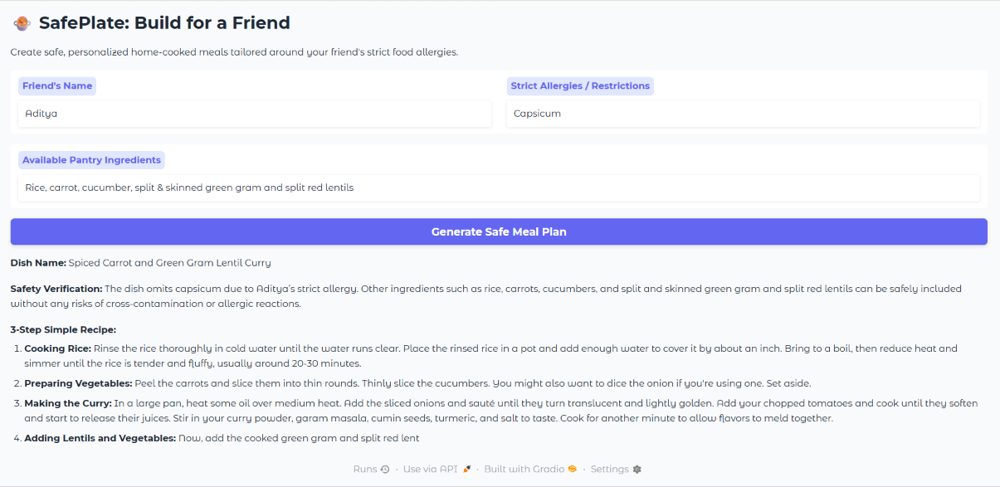

#  SafePlate: Build for a Friend

**SafePlate** is an open-source, AI-powered meal planning application built for the **Hacktoberfest Week 1: Build it for a Friend** challenge.

It helps developers generate personalized, allergen-safe home-cooked recipes tailored specifically around a friend's strict dietary restrictions, ensuring food safety while utilizing available pantry ingredients.

---

##  Demo & Output

---

##  Key Features & Safety Guardrails
- **Allergen Verification Audit:** Explicit safety check step to guarantee zero cross-contamination or accidental inclusion of flagged allergens.
- **Pantry-Aware Recipe Generation:** Tailors 3-step simple recipes (<20 mins prep) based strictly on ingredients currently available in the kitchen.
- **Privacy-First & Open-Weights:** Runs locally using `Qwen/Qwen2.5-1.5B-Instruct` via Hugging Face `transformers` with zero external API calls or tracking.
- **Interactive UI:** Clean, intuitive dashboard interface built using Gradio.

---

##  Tech Stack
- **Language:** Python 3.10+ (`SafePlate-BuildForAFriend.py`)
- **Model:** `Qwen/Qwen2.5-1.5B-Instruct`
- **Frameworks:** PyTorch, Hugging Face `transformers`, `accelerate`
- **Frontend/UI:** Gradio (`gr.Blocks`)

---

##  License
This project is open-source under the MIT License. Built with  for Hacktoberfest Open-Source AI Challenge.
